[# testEmployeeCrud

proyecto para manejo de ramas

# 📊 Diagrama de Arquitectura - Sistema de Microservicios con Discord

## 🏗️ Arquitectura General del Sistema

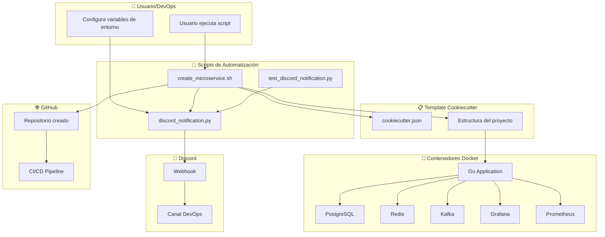

## 🔄 Flujo de Creación de Microservicio

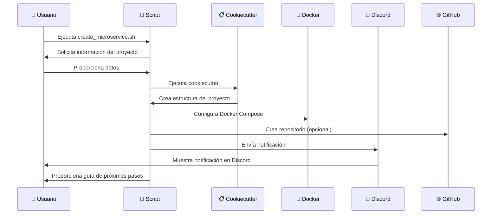

## 🎯 Estructura de Archivos del Sistema

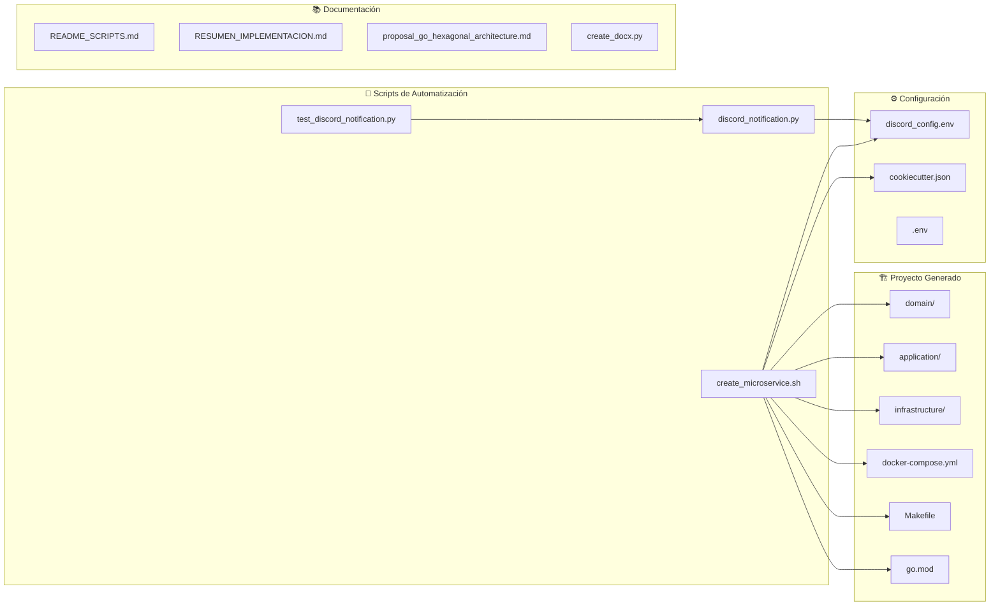

## 🔧 Arquitectura Hexagonal del Microservicio

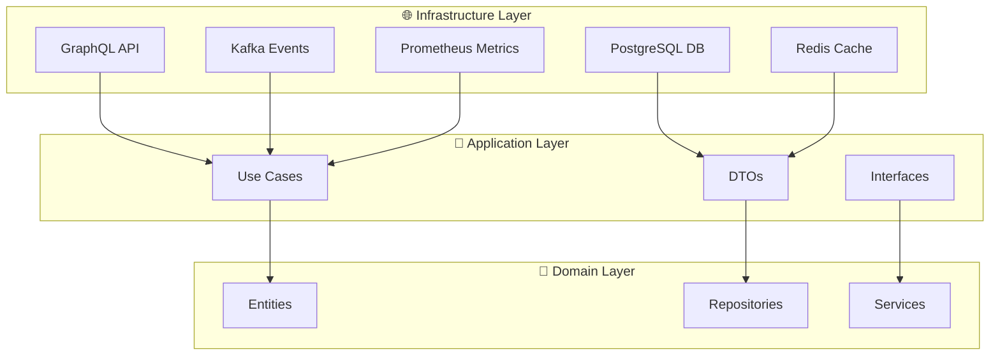

## 📱 Flujo de Notificación Discord

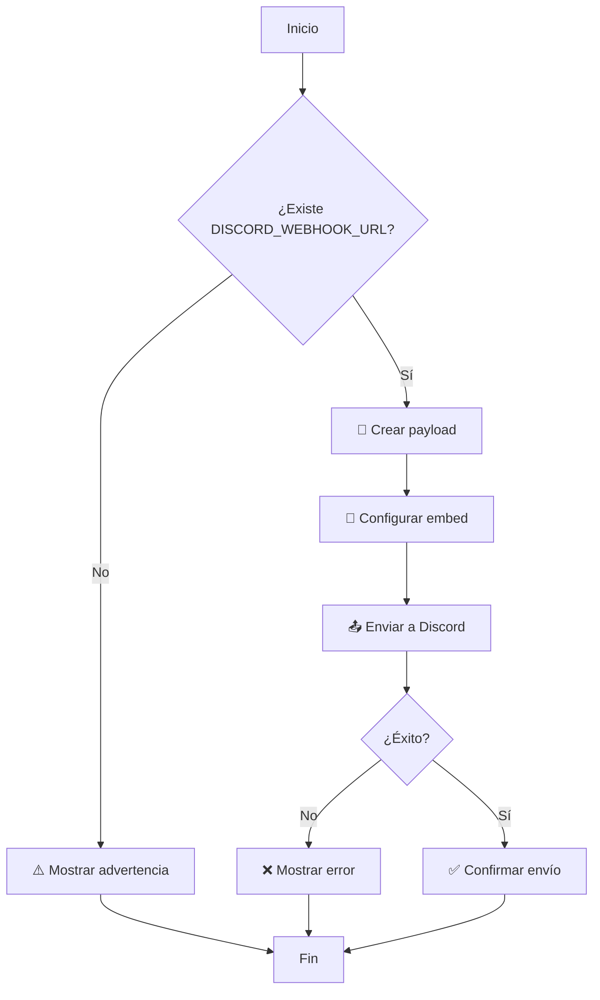

## 🐳 Arquitectura de Contenedores

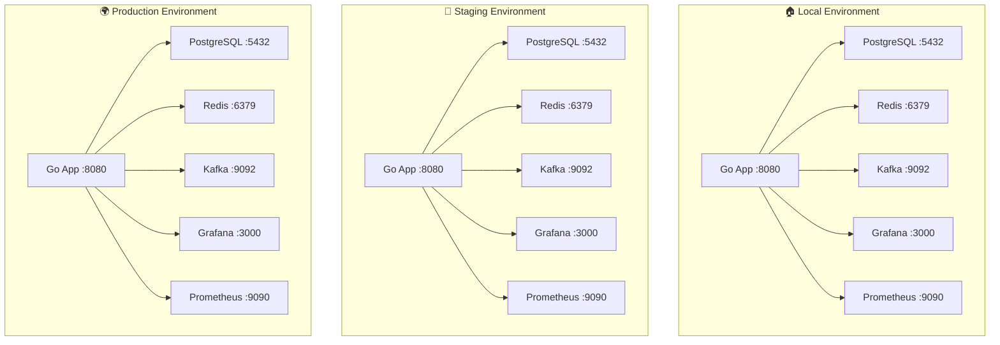

## 🎨 Ejemplo de Notificación Discord

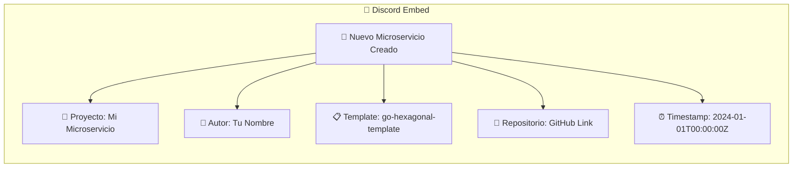

## 🔄 CI/CD Pipeline

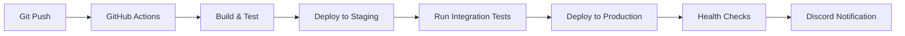

## 📊 Monitoreo y Observabilidad

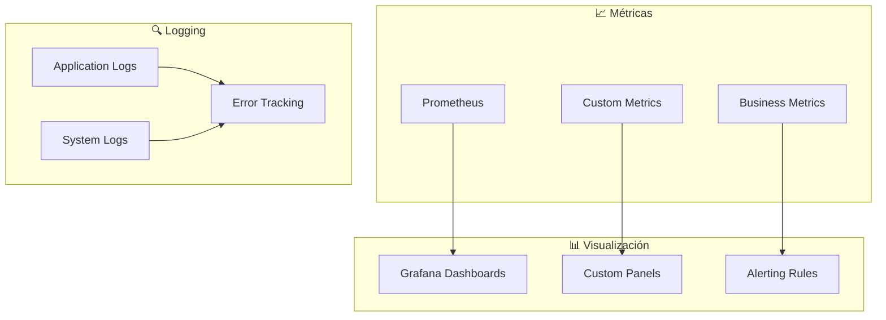

## 🎯 Casos de Uso del Sistema

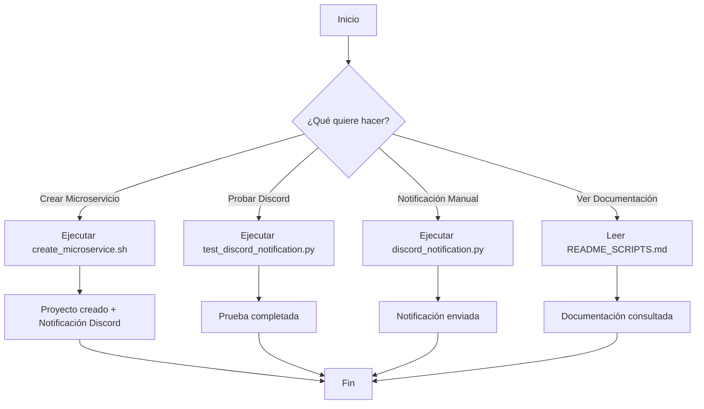

---

## 📋 Resumen del Diagrama

### 🎯 **Componentes Principales:**
1. **Scripts de Automatización** - Manejan todo el proceso
2. **Template Cookiecutter** - Genera la estructura del proyecto
3. **Contenedores Docker** - Ejecutan los servicios
4. **Discord** - Recibe notificaciones
5. **GitHub** - Almacena el código

### 🔄 **Flujo Principal:**
1. Usuario ejecuta script
2. Se crea proyecto con Cookiecutter
3. Se configuran contenedores Docker
4. Se envía notificación a Discord
5. Se crea repositorio en GitHub

### 🎨 **Características Destacadas:**
- **Arquitectura Hexagonal** - Separación clara de responsabilidades
- **Multi-entorno** - Local, Staging, Producción
- **Monitoreo Completo** - Prometheus + Grafana
- **Notificaciones Automáticas** - Discord en tiempo real
- **Automatización Total** - Un comando para todo

**¡El sistema está completamente diagramado y listo para implementar! 🚀**


# 📁 Diagrama de Estructura de Archivos - Sistema Completo

## 🗂️ Estructura de Directorios del Sistema

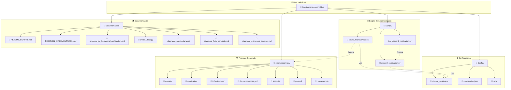

## 🔗 Relaciones entre Archivos

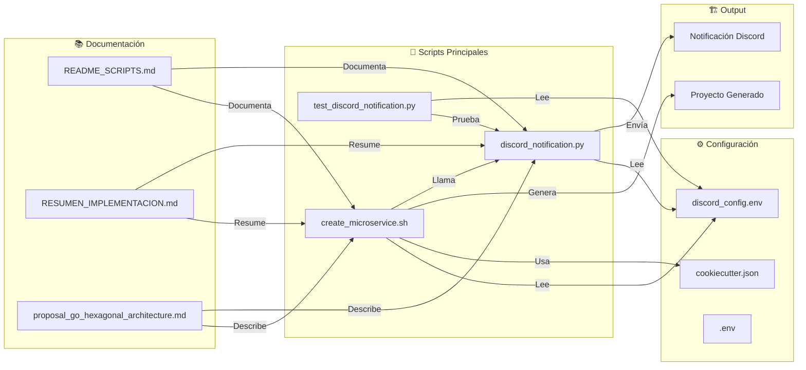

## 📋 Flujo de Dependencias

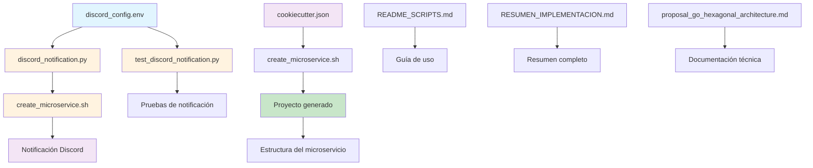

## 🎯 Estructura del Proyecto Generado

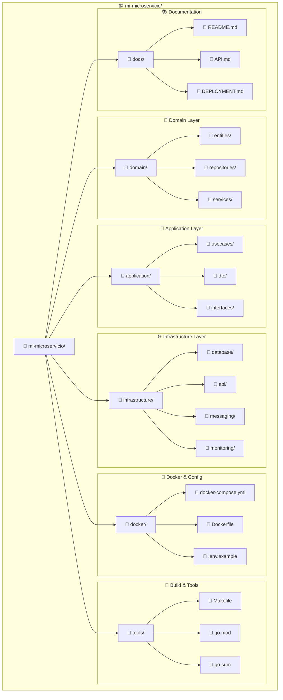

## 🔄 Flujo de Ejecución de Archivos

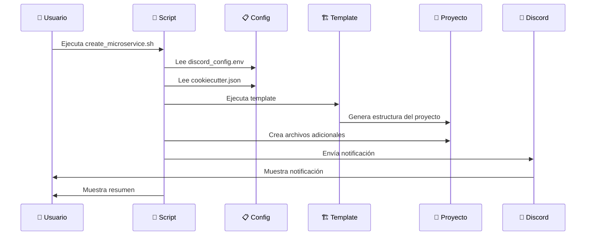

## 📊 Mapa de Archivos por Función

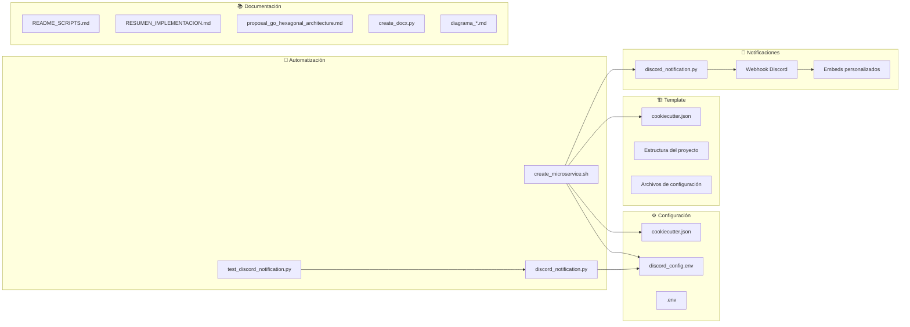

## 🎨 Estructura de Configuración

```mermaid
graph TB
    subgraph "🔧 Variables de Entorno"
        A[DISCORD_WEBHOOK_URL]
        B[DISCORD_CHANNEL_ID]
        C[DISCORD_BOT_TOKEN]
        D[LOG_LEVEL]
        E[LOG_FILE]
    end
    
    subgraph "📋 Template Config"
        F[project_name]
        G[project_description]
        H[author_name]
        I[author_email]
        J[github_username]
        K[go_version]
        L[graphql_enabled]
        M[monitoring_enabled]
        N[use_postgresql]
        O[use_redis]
        P[use_kafka]
        Q[app_port]
        R[grafana_port]
        S[prometheus_port]
    end
    
    subgraph "📄 Archivos de Config"
        T[discord_config.env]
        U[cookiecutter.json]
        V[.env]
    end
    
    T --> A
    T --> B
    T --> C
    T --> D
    T --> E
    
    U --> F
    U --> G
    U --> H
    U --> I
    U --> J
    U --> K
    U --> L
    U --> M
    U --> N
    U --> O
    U --> P
    U --> Q
    U --> R
    U --> S
    
    V --> A
    V --> B
    V --> C
```

## 🔄 Flujo de Datos entre Archivos

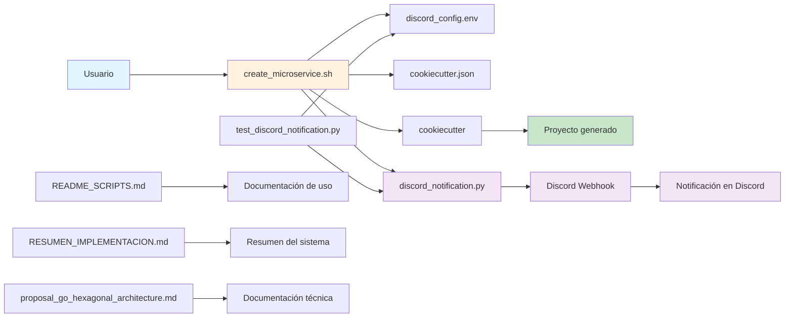

---

## 📋 Resumen de la Estructura

### 🎯 **Archivos Principales:**

1. **Scripts de Automatización**
   - `create_microservice.sh` - Script principal
   - `discord_notification.py` - Notificaciones Discord
   - `test_discord_notification.py` - Pruebas

2. **Configuración**
   - `discord_config.env` - Variables Discord
   - `cookiecutter.json` - Template config
   - `.env` - Variables locales

3. **Documentación**
   - `README_SCRIPTS.md` - Guía de uso
   - `RESUMEN_IMPLEMENTACION.md` - Resumen
   - `proposal_go_hexagonal_architecture.md` - Documentación técnica
   - `diagrama_*.md` - Diagramas visuales

### 🔄 **Flujo de Dependencias:**

- Los scripts leen la configuración
- El script principal genera el proyecto
- Se envía notificación automática
- La documentación explica el proceso

### 🎨 **Características:**

- **Modular** - Cada archivo tiene una función específica
- **Configurable** - Variables de entorno flexibles
- **Documentado** - Guías completas
- **Probable** - Scripts de testing incluidos
- **Visual** - Diagramas explicativos

**¡La estructura está completamente organizada y documentada! 🚀**


# 🔄 Diagrama de Flujo Completo - Sistema de Microservicios

## 🎯 Flujo Principal de Creación de Microservicio

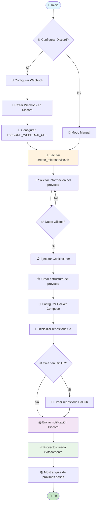

## 🔧 Proceso Detallado de Automatización

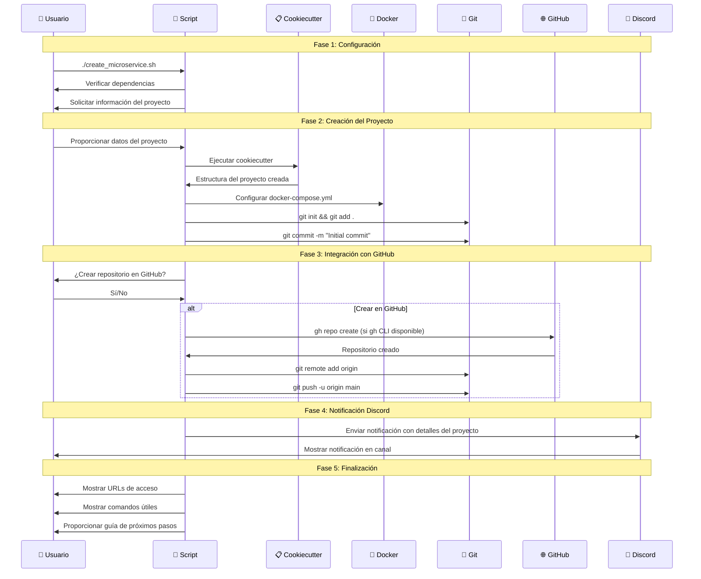

## 🎨 Estructura de la Notificación Discord

```mermaid
graph TB
    subgraph "📱 Discord Webhook"
        A[Webhook URL]
        B[Payload JSON]
        C[Embed Object]
    end
    
    subgraph "🎨 Embed Content"
        D[Title: 🚀 Nuevo Microservicio Creado]
        E[Color: 0x00ff00]
        F[Fields Array]
        G[Footer: Go Hexagonal Architecture Template]
        H[Timestamp: ISO 8601]
    end
    
    subgraph "📋 Fields"
        I[📁 Proyecto: project_name]
        J[👤 Autor: author_name]
        K[📋 Template: template_name]
        L[🔗 Repositorio: github_url]
    end
    
    A --> B
    B --> C
    C --> D
    C --> E
    C --> F
    C --> G
    C --> H
    F --> I
    F --> J
    F --> K
    F --> L
```

## 🐳 Arquitectura de Servicios por Entorno

```mermaid
graph TB
    subgraph "🏠 Local Development"
        L1[Go App :8080]
        L2[PostgreSQL :5432]
        L3[Redis :6379]
        L4[Kafka :9092]
        L5[Grafana :3000]
        L6[Prometheus :9090]
    end
    
    subgraph "🚀 Staging Environment"
        S1[Go App :8080]
        S2[PostgreSQL :5432]
        S3[Redis :6379]
        S4[Kafka :9092]
        S5[Grafana :3000]
        S6[Prometheus :9090]
    end
    
    subgraph "🌍 Production Environment"
        P1[Go App :8080]
        P2[PostgreSQL :5432]
        P3[Redis :6379]
        P4[Kafka :9092]
        P5[Grafana :3000]
        P6[Prometheus :9090]
    end
    
    L1 -.->|Optional| L2
    L1 -.->|Optional| L3
    L1 -.->|Optional| L4
    L1 --> L5
    L1 --> L6
    
    S1 --> S2
    S1 --> S3
    S1 --> S4
    S1 --> S5
    S1 --> S6
    
    P1 --> P2
    P1 --> P3
    P1 --> P4
    P1 --> P5
    P1 --> P6
```

## 🔄 Flujo de Decisiones del Script

```mermaid
flowchart TD
    A[Inicio] --> B{¿Cookiecutter instalado?}
    B -->|No| C[Instalar cookiecutter]
    B -->|Sí| D[Solicitar información del proyecto]
    C --> D
    
    D --> E[Configurar opciones del template]
    E --> F{¿Usar PostgreSQL?}
    F -->|Sí| G[Incluir PostgreSQL]
    F -->|No| H[Saltar PostgreSQL]
    
    E --> I{¿Usar Redis?}
    I -->|Sí| J[Incluir Redis]
    I -->|No| K[Saltar Redis]
    
    E --> L{¿Usar Kafka?}
    L -->|Sí| M[Incluir Kafka]
    L -->|No| N[Saltar Kafka]
    
    G --> O[Crear proyecto]
    H --> O
    J --> O
    K --> O
    M --> O
    N --> O
    
    O --> P{¿Crear en GitHub?}
    P -->|Sí| Q[Crear repositorio]
    P -->|No| R[Saltar GitHub]
    
    Q --> S[Enviar notificación Discord]
    R --> S
    
    S --> T[Mostrar resumen]
    T --> U[Fin]
```

## 📊 Monitoreo y Observabilidad

```mermaid
graph LR
    subgraph "📈 Data Collection"
        A[Application Metrics]
        B[System Metrics]
        C[Business Metrics]
        D[Custom Metrics]
    end
    
    subgraph "📊 Storage & Processing"
        E[Prometheus]
        F[Time Series DB]
        G[Alert Manager]
    end
    
    subgraph "📱 Visualization"
        H[Grafana Dashboards]
        I[Custom Panels]
        J[Alerting Rules]
    end
    
    subgraph "🔔 Notifications"
        K[Discord Alerts]
        L[Email Notifications]
        M[Slack Integration]
    end
    
    A --> E
    B --> E
    C --> E
    D --> E
    E --> F
    E --> G
    F --> H
    F --> I
    G --> J
    J --> K
    J --> L
    J --> M
```

## 🎯 Casos de Uso y Escenarios

```mermaid
graph TD
    A[Usuario quiere crear microservicio] --> B{¿Tiene experiencia?}
    
    B -->|Experto| C[Modo avanzado]
    B -->|Novato| D[Modo guiado]
    
    C --> E[Configuración manual]
    D --> F[Script interactivo]
    
    E --> G[Crear proyecto]
    F --> G
    
    G --> H{¿Necesita base de datos?}
    H -->|Sí| I[Incluir PostgreSQL]
    H -->|No| J[Saltar base de datos]
    
    G --> K{¿Necesita cache?}
    K -->|Sí| L[Incluir Redis]
    K -->|No| M[Saltar cache]
    
    G --> N{¿Necesita eventos?}
    N -->|Sí| O[Incluir Kafka]
    N -->|No| P[Saltar eventos]
    
    I --> Q[Proyecto configurado]
    J --> Q
    L --> Q
    M --> Q
    O --> Q
    P --> Q
    
    Q --> R[Notificación Discord]
    R --> S[Proyecto listo]
```

## 🔧 Arquitectura Técnica Detallada

```mermaid
graph TB
    subgraph "🌐 External Interfaces"
        A1[GraphQL API]
        A2[REST API]
        A3[gRPC API]
    end
    
    subgraph "🎯 Application Services"
        B1[Use Case Handlers]
        B2[Command Handlers]
        B3[Query Handlers]
        B4[Event Handlers]
    end
    
    subgraph "💼 Domain Layer"
        C1[Entities]
        C2[Value Objects]
        C3[Domain Services]
        C4[Repository Interfaces]
    end
    
    subgraph "🏗️ Infrastructure"
        D1[PostgreSQL Repository]
        D2[Redis Cache]
        D3[Kafka Producer/Consumer]
        D4[Prometheus Metrics]
        D5[Logging Service]
    end
    
    A1 --> B1
    A2 --> B2
    A3 --> B3
    B1 --> C1
    B2 --> C2
    B3 --> C3
    B4 --> C4
    C4 --> D1
    C1 --> D2
    C3 --> D3
    B1 --> D4
    B1 --> D5
```

---

## 📋 Resumen del Flujo Completo

### 🎯 **Fases del Proceso:**

1. **Configuración** - Preparar entorno y Discord
2. **Entrada de Datos** - Información del proyecto
3. **Generación** - Crear estructura con Cookiecutter
4. **Configuración** - Docker, Git, GitHub
5. **Notificación** - Enviar a Discord
6. **Finalización** - Guía y resumen

### 🔧 **Componentes Clave:**

- **Scripts Automatizados** - Manejan todo el flujo
- **Template Cookiecutter** - Genera estructura estándar
- **Docker Compose** - Orquesta servicios
- **Discord Webhook** - Notificaciones en tiempo real
- **GitHub Integration** - Control de versiones

### 🎨 **Características Destacadas:**

- **Flexibilidad** - Servicios opcionales (PostgreSQL, Redis, Kafka)
- **Automatización** - Un comando para todo
- **Notificaciones** - Feedback inmediato
- **Multi-entorno** - Local, Staging, Producción
- **Monitoreo** - Observabilidad completa

**¡El flujo está completamente diagramado y optimizado! 🚀**
